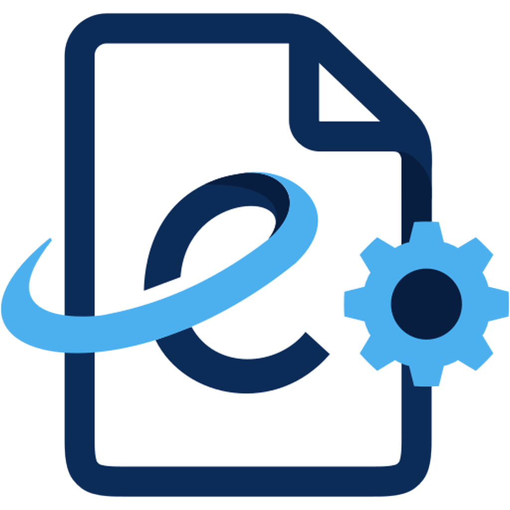

<p align="center">
  <a href="https://easypdf.asteritilfa.it/"></a><br>
  
</p>

# easyPDF 2.0

[Sito ufficiale](https://easypdf.asteritilfa.it/) · [Documentazione](https://easypdf.asteritilfa.it/documentazione/) · [Versioni e download](https://github.com/LFA-Asteriti/easyPDF/releases)

easyPDF è la piattaforma Twinba Srl per leggere, modificare, organizzare, firmare,
proteggere e convertire documenti PDF su desktop e sul web.

## Release e download

- [Tutte le release e le note di versione](https://github.com/LFA-Asteriti/easyPDF/releases)
- [Ultima release pubblicata](https://github.com/LFA-Asteriti/easyPDF/releases/latest)

I pacchetti desktop saranno disponibili nelle release di questo repository.
Il collegamento all'ultima release diventerà attivo alla prima pubblicazione.

## Obiettivi del progetto

- una sola base PDF in Rust per applicazione desktop, browser WASM, CLI e servizi web;
- elaborazione locale quando possibile e nessun URL esterno necessario per le cover;
- portale web riservato agli utenti autorizzati;
- set di cover frontali e posteriori caricabili, riutilizzabili e selezionabili come predefiniti;
- operazioni annullabili e salvataggi atomici, senza perdere dati PDF sconosciuti;
- distribuzione su VPS con DirectAdmin e MySQL.

## Applica cover

L'operazione `doc_apply_covers` accetta una cover frontale, una posteriore oppure entrambe.
Tutte le pagine della cover frontale vengono anteposte al documento e tutte le pagine della
cover posteriore vengono aggiunte in coda. L'operazione è atomica: se una cover non è valida,
il documento non viene modificato. Desktop, web e CLI condividono la stessa implementazione.

Esempio di script CLI:

```json
[
  {"tool":"doc_open","args":{"path":"documento.pdf"}},
  {"tool":"doc_apply_covers","args":{"doc":1,"front":"front.pdf","back":"back.pdf"}},
  {"tool":"doc_save","args":{"doc":1,"path":"documento-con-cover.pdf"}}
]
```

## Sviluppo

Serve Rust 1.95 o successivo. Su Windows occorrono inoltre i Microsoft C++ Build Tools.

Dalla cartella principale del progetto:

```powershell
# Avvia l'app desktop
cargo run -p easypdf

# Avvia l'app aprendo subito un documento
cargo run -p easypdf -- "C:\percorso\documento.pdf"

# Elenca gli strumenti disponibili nella CLI
cargo run -p easypdf-cli -- tools
```

Per il frontend web installare anche `trunk` e il target WASM, quindi eseguire:

```powershell
rustup target add wasm32-unknown-unknown
cargo install trunk
Set-Location apps/easypdf-web
trunk serve
```

## Licenze e attribuzioni

Il marchio e gli asset easyPDF sono proprietà di Twinba Srl e seguono
[`assets/LICENSE-easyPDF-brand.txt`](assets/LICENSE-easyPDF-brand.txt).

Il progetto incorpora componenti di terze parti e codice derivato distribuito secondo i rispettivi
termini. Le licenze MIT e Apache-2.0 applicabili sono conservate in `LICENSE-MIT` e
`LICENSE-APACHE`; gli avvisi obbligatori rimangono in `NOTICE`, `ATTRIBUTION.toml` e
`ATTRIBUTION.md`.
